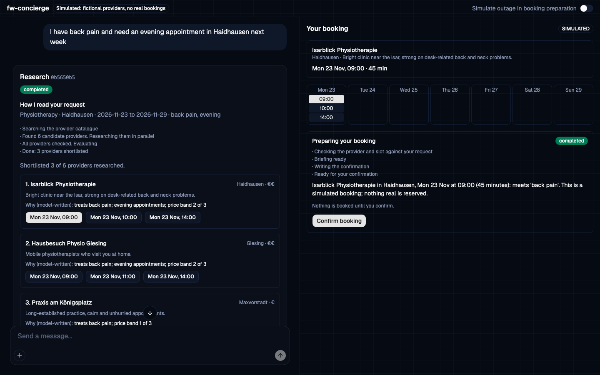

# fw-concierge

A small, production-shaped demo of [featherweight](https://github.com/aadhithya/featherweight): a chat assistant that finds a
physiotherapy appointment in Munich, researches providers on a background worker, and books after an explicit confirmation.

> **Everything is fictional.** The providers, slots and bookings are made up and simulated. Nothing is booked, and nothing here
> is medical advice.

You talk to the assistant on the left; the booking flow is on the right.



```
make up        # build and start everything, then open http://localhost:8000
make demo      # a scripted walkthrough of the whole flow, in the terminal
make traces    # open Jaeger to see one trace across the API and the worker
make help      # every command
```

It starts in **demo mode**: deterministic fake models, no API key, works offline. Set `DEMO_MODE=0` and `GOOGLE_API_KEY` in `.env`
for live mode (Gemini `gemini-3.5-flash-lite`, or `LLM=gemma` for the big hosted Gemma, which is free).

## What it shows

| featherweight feature | Where |
|---|---|
| A streaming chat agent, streamed over AG-UI | `backend/concierge/chat.py` |
| A background agent: the chat starts a job and carries on | `Concierge.background_agents` |
| A job with agents running in parallel, on a separate worker | `backend/concierge/research.py` |
| A resumable job: fails after its first agent, retry reuses it | `backend/concierge/booking_prep.py` |
| Your own queue and result store, checked with the conformance kits | `backend/concierge/fw_adapters.py` |
| One OpenTelemetry trace from the API request to the worker's agents | `docs/guide.md` |

## Docs

- [Architecture](docs/architecture.md): the containers, the data, who owns what.
- [Getting started](docs/getting-started.md): setup, commands, the demo walkthrough, troubleshooting.
- [Guide](docs/guide.md): how the agents and jobs work, lifecycle, failures, traces, limitations.
