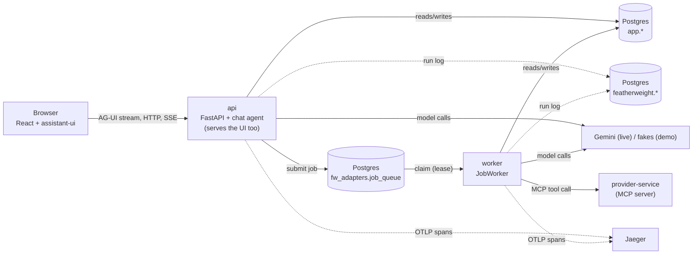

# Architecture

Six containers from one `compose.yaml`. The API, the worker and the MCP service are **one image with three commands**.

| Container | Does |
|---|---|
| `postgres` | One database, three schemas (below) |
| `migrate` | One-shot: applies the SQL migrations and seeds the fictional providers, then exits |
| `api` | Serves the UI and the API: the AG-UI chat stream, job status/progress (SSE), retry, bookings. Runs the chat agent and **submits** jobs. Never runs one |
| `worker` | Claims submitted jobs from the queue and runs them: the research and the booking preparation |
| `provider-service` | A mock provider service: an MCP server with one slow tool, `search_providers`. The research agent calls it over MCP and forwards its answer |
| `jaeger` | Trace backend (in memory: traces are lost on restart) |

The API and the worker meet only in Postgres: the queue and the database. The browser talks only to the API's HTTP endpoints and
the AG-UI stream. It never sees featherweight's run log, queue or agent classes.

## Who owns what

**The application owns its domain data. featherweight owns agent execution.**

| Schema | Owner | Holds |
|---|---|---|
| `app` | The application | `providers`, `availability_slots` (the mock catalogue), `appointment_requests` (the research request), `preparations`, `bookings`, `job_progress` (what the UI shows), and **`job_results`**, the output store behind featherweight's `ResultStore` |
| `featherweight` | The framework | The run log: jobs, agent runs (status, tokens, timing, hashes), job events and leases. Created by `PostgresDatabase` |
| `fw_adapters` | The application, for the framework | `job_queue`, behind featherweight's `JobQueue` |

`job_results` is application data on purpose: it holds user content, and in a multi-tenant app it would be tenant-scoped, so it
lives under the app's own retention and access rules. featherweight keeps metadata only (status, tokens, timing, hashes), never
inputs or outputs.

Agents never touch these tables. They reach providers and availability only through two interfaces in `domain.py`
(`ProviderCatalog`, `AvailabilityService`); the mock availability can be replaced without touching the agents or the jobs.

## Two jobs, two roles

| | `Researcher` (an agent) | `prepare_booking` (a job) |
|---|---|---|
| Started by | The chat agent, as a **background agent** | The "Prepare booking" button, with `client.submit(..., resumable=True)` |
| Agents | `Researcher`: one agent, one MCP tool that sleeps and returns the findings | `BookingBriefer`, then `ConfirmationWriter` |
| Retry | A new run with the same request | **Resume**: the finished first agent is reused |
